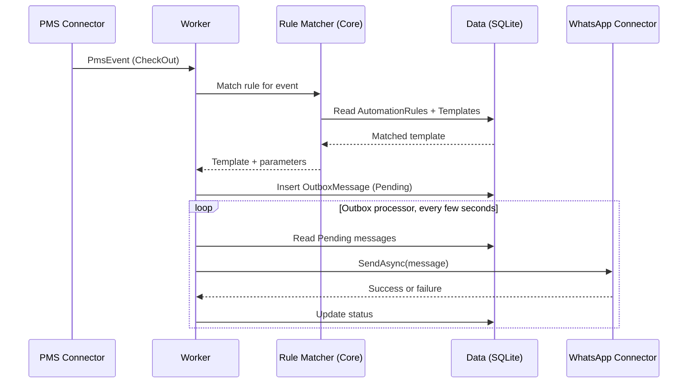

# Hotel WhatsApp Automation — System Architecture

**Purpose of this document:** a single reference you can keep open while building in Visual Studio. It shows every project, every planned file, which database table each file touches, how one real event flows end-to-end, and which design principles keep the system from breaking itself as it grows.

---

## 1. System at a Glance

```
                     ┌────────────────────┐
                     │   Desktop UI         │   (Blazor Hybrid, built later)
                     └─────────┬───────────┘
                               │ local API / IPC
                     ┌─────────▼───────────┐
                     │  Worker (Host)       │   <- the only project allowed
                     │  - Program.cs (DI)   │      to know about every other
                     │  - Worker.cs         │      project at once
                     │  - OutboxProcessor   │
                     └──┬────────┬───────┬──┘
           ┌────────────┘        │       └────────────┐
┌──────────▼──────────┐ ┌────────▼────────┐ ┌──────────▼──────────┐
│ Connectors.WhatsApp  │ │  Data (SQLite)   │ │  Connectors.Pms      │
│ - WhatsAppApiClient  │ │  - Repositories  │ │  - ManualPmsConnector │
│ - WhatsAppSender     │ │  - Schema.sql    │ │  - (later: DB/print)  │
└──────────┬───────────┘ └────────┬────────┘ └──────────┬────────────┘
           │                      │                      │
           └──────────────┬───────┴───────────┬──────────┘
                           ▼                   ▼
                 ┌──────────────────────────────────┐
                 │        HotelAutomation.Core        │
                 │   Models + Interfaces only.         │
                 │   Everyone depends on this;          │
                 │   this depends on nothing.            │
                 └──────────────────────────────────┘
```

**The one rule that matters most:** arrows only point *inward*, toward Core. Nothing in Core ever references Data, a Connector, or the Worker. This is what makes the pieces swappable and crash-isolated from each other.

---

## 2. The Projects

| Project | Type | Job | References |
|---|---|---|---|
| `HotelAutomation.Core` | Class Library | Shared contracts: models + interfaces. No logic, no infrastructure. | *(nothing)* |
| `HotelAutomation.Data` | Class Library | SQLite access, hidden behind repository classes. | Core |
| `HotelAutomation.Connectors.WhatsApp` | Class Library | Sends messages via Meta's Cloud API. Your proven test code lives here. | Core |
| `HotelAutomation.Connectors.Pms` | Class Library | Detects hotel events (check-in/out, bill). Starts as a manual stand-in. | Core |
| `HotelAutomation.Worker` | Worker Service | Background engine. The only project that wires everything together. | All four above |
| `HotelAutomation.UI` *(later)* | Blazor Hybrid | Staff-facing desktop window. Talks to Worker, never to connectors directly. | Core only (via a thin API) |

Notice `Connectors.WhatsApp` and `Connectors.Pms` never reference each other, and neither references `Data`. That's not an accident — it's the mechanism that stops one fix from breaking an unrelated feature.

---

## 3. File-by-File Map

### `HotelAutomation.Core`
No infrastructure, no SQL, no HTTP — just shapes and contracts.

| File | Responsibility |
|---|---|
| `Models/PmsEvent.cs` | One hotel event: `EventType`, `GuestName`, `PhoneNumber`, `RoomNumber`, `Amount`, `Timestamp` |
| `Models/MessageTemplate.cs` | Mirrors a Meta-approved template: `Id`, `Name`, `ExternalTemplateName`, `LanguageCode` |
| `Models/AutomationRule.cs` | Links a trigger event type to a template: `TriggerEventType`, `TemplateId`, `IsEnabled` |
| `Models/OutboxMessage.cs` | One queued message: `ToPhoneNumber`, `TemplateId`, `ParametersJson`, `Status`, `RetryCount` |
| `Interfaces/IPmsEventSource.cs` | Contract every PMS connector must implement (raises `PmsEvent`) |
| `Interfaces/IMessageChannel.cs` | Contract every sender must implement: `SendAsync(OutboxMessage)` |
| `Interfaces/IOutboxRepository.cs` | Contract for reading/writing the outbox queue |
| `Interfaces/ITemplateRepository.cs` / `IRuleRepository.cs` | Contracts for reading templates and rules |
| `Engine/AutomationRuleMatcher.cs` | Pure logic: given an event + the list of rules, returns the matching template. No database, no I/O — fully testable on its own. |

### `HotelAutomation.Data`
Implements Core's repository interfaces. **This is the only project allowed to contain SQL.**

| File | Responsibility | Table(s) touched |
|---|---|---|
| `Schema.sql` | Creates all tables on first run | all |
| `SqliteConnectionFactory.cs` | Opens the connection to the local `.db` file | — |
| `Repositories/TemplateRepository.cs` | Implements `ITemplateRepository` | `MessageTemplates` |
| `Repositories/RuleRepository.cs` | Implements `IRuleRepository` | `AutomationRules` |
| `Repositories/OutboxRepository.cs` | Implements `IOutboxRepository` | `OutboxMessages` |
| `Repositories/EventLogRepository.cs` | Writes an audit trail row for every event handled | `EventLog` |

### `HotelAutomation.Connectors.WhatsApp`
Your working console-app code moves here almost unchanged.

| File | Responsibility |
|---|---|
| `WhatsAppApiClient.cs` | Raw HTTP calls to Meta's Graph API — the `HttpClient` code you already tested |
| `WhatsAppMessageSender.cs` | Implements `IMessageChannel`; converts an `OutboxMessage` into the JSON payload `WhatsAppApiClient` needs |
| `WhatsAppOptions.cs` | Strongly-typed settings (`AccessToken`, `PhoneNumberId`) bound from config/secrets |

### `HotelAutomation.Connectors.Pms`
Starts as a stand-in so we can build and test the whole pipeline before the real PMS reconnaissance is finished.

| File | Responsibility |
|---|---|
| `ManualPmsConnector.cs` | Implements `IPmsEventSource`; exposes a method to manually raise a test event (stand-in for a real check-out) |
| *(later)* `DatabasePmsConnector.cs` | Reads the legacy software's DB directly, once we know the schema |
| *(later)* `PrintCaptureConnector.cs` | Watches printed bills via a virtual printer, per the reconnaissance plan |

Adding either of these later means **creating a new file, not editing an existing one** — that's the Open/Closed Principle in section 6.

### `HotelAutomation.Worker`
The orchestrator. The only project that references all the others.

| File | Responsibility |
|---|---|
| `Program.cs` | Wires every interface to its concrete implementation (dependency injection). The single place that "knows everything." |
| `Worker.cs` | Background service: listens for `PmsEvent`s, asks the rule matcher for a template, writes a new `OutboxMessage` |
| `OutboxProcessor.cs` | Runs every few seconds: reads `Pending` outbox rows, calls `IMessageChannel.SendAsync`, updates status. This loop is what makes the app offline-safe. |
| `appsettings.json` / user secrets | Local configuration |

---

## 4. How One Real Event Flows Through the System

Walkthrough for a guest checking out:

1. A PMS connector (today: `ManualPmsConnector`; later: the real one) detects the event and raises a `PmsEvent { EventType = "CheckOut", GuestName, PhoneNumber, RoomNumber, Amount }`.
2. `Worker.cs` receives it and asks `AutomationRuleMatcher` (Core) to find a matching rule.
3. The matcher asks `IRuleRepository` for enabled rules where `TriggerEventType == "CheckOut"`, finds one pointing at the `checkout_bill` template.
4. `Worker.cs` builds an `OutboxMessage` (phone number + template parameters) and saves it via `IOutboxRepository` → an `INSERT` into `OutboxMessages` with `Status = Pending`.
5. `OutboxProcessor` (running continuously) picks up the pending row and calls `IMessageChannel.SendAsync` — at runtime this resolves to `WhatsAppMessageSender`.
6. On success: status becomes `Sent`, and `EventLogRepository` writes an audit row.
7. On failure (no internet, API error): the row stays `Pending`, `RetryCount` increments, and it's retried automatically — **nothing is lost**.



---

## 5. Database Schema (SQLite)

```sql
CREATE TABLE MessageTemplates (
    Id INTEGER PRIMARY KEY AUTOINCREMENT,
    Name TEXT NOT NULL,                  -- internal name, e.g. "Checkout Bill"
    ExternalTemplateName TEXT NOT NULL,  -- must exactly match the Meta-approved template name
    LanguageCode TEXT NOT NULL DEFAULT 'en',
    ChannelType TEXT NOT NULL DEFAULT 'WhatsApp',
    CreatedAt TEXT NOT NULL
);

CREATE TABLE AutomationRules (
    Id INTEGER PRIMARY KEY AUTOINCREMENT,
    TriggerEventType TEXT NOT NULL,      -- 'CheckIn', 'CheckOut', 'BillGenerated', ...
    TemplateId INTEGER NOT NULL REFERENCES MessageTemplates(Id),
    IsEnabled INTEGER NOT NULL DEFAULT 1,
    ConditionsJson TEXT NULL             -- optional extra matching logic
);

CREATE TABLE OutboxMessages (
    Id INTEGER PRIMARY KEY AUTOINCREMENT,
    ToPhoneNumber TEXT NOT NULL,
    TemplateId INTEGER NOT NULL REFERENCES MessageTemplates(Id),
    ParametersJson TEXT NOT NULL,
    Status TEXT NOT NULL DEFAULT 'Pending',   -- Pending | Sent | Failed
    RetryCount INTEGER NOT NULL DEFAULT 0,
    CreatedAt TEXT NOT NULL,
    SentAt TEXT NULL
);

CREATE TABLE EventLog (
    Id INTEGER PRIMARY KEY AUTOINCREMENT,
    EventType TEXT NOT NULL,
    RawPayloadJson TEXT NULL,
    OutboxMessageId INTEGER NULL REFERENCES OutboxMessages(Id),
    OccurredAt TEXT NOT NULL
);

CREATE TABLE AppConfig (
    Key TEXT PRIMARY KEY,
    Value TEXT NOT NULL   -- sensitive values (tokens) are DPAPI-encrypted before being stored here
);
```

| Table | Written by | Read by |
|---|---|---|
| `MessageTemplates` | Setup/admin screen (UI, later) | `AutomationRuleMatcher`, `WhatsAppMessageSender` |
| `AutomationRules` | Setup/admin screen (UI, later) | `AutomationRuleMatcher` |
| `OutboxMessages` | `Worker.cs` (insert), `OutboxProcessor` (update) | `OutboxProcessor` |
| `EventLog` | `EventLogRepository` | Future reporting/dashboard |
| `AppConfig` | Setup screen / installer | `WhatsAppOptions`, any connector needing config |

---

## 6. The Rules That Keep Modules From Breaking Each Other

1. **Only `Core` is referenced by everything.** No other project is a shared dependency.
2. **Connectors never reference each other.** `Connectors.WhatsApp` cannot see `Connectors.Pms`, and vice versa — physically impossible to accidentally couple them.
3. **`Data` is the only project allowed to contain SQL.** If you ever see a SQL string outside `HotelAutomation.Data`, that's a red flag.
4. **`Worker`'s `Program.cs` is the only file allowed to "know everything."** Every other file only knows about interfaces it needs, not concrete classes.
5. **The UI never talks to a connector directly** — only to the Worker, through a small local API. A UI crash can't take down the background engine, and an engine restart doesn't close the UI.
6. **Adding a feature means adding a file, not editing one.** A new PMS type or a new messaging channel = a new class implementing an existing interface + one line in `Program.cs`'s DI setup.

---

## 7. Design Principles & Patterns Applied

| Principle / Pattern | Where it's applied | Why it matters for you |
|---|---|---|
| Separation of Concerns | One project = one job | Open only the project related to your bug — the rest is untouched |
| Dependency Inversion (the "D" in SOLID) | Core owns the interfaces; Data & Connectors implement them | High-level logic never depends on low-level detail — swap WhatsApp for SMS later without touching the rule engine |
| Single Responsibility | e.g. `WhatsAppApiClient` only does HTTP; `WhatsAppMessageSender` only adapts data | Small, testable, easy-to-debug classes |
| Open/Closed Principle | New PMS type = new class, zero edits elsewhere | This is the direct fix for "changing one thing breaks another" |
| Strategy Pattern | `IMessageChannel`, `IPmsEventSource` are swappable strategies chosen at startup | Same rule engine works with any channel or PMS |
| Repository Pattern | `Data` hides all SQL behind repository classes | Core/Worker never see raw SQL; swapping storage later stays contained |
| Outbox Pattern | `OutboxMessages` table + retry loop | No message is ever lost, even through crashes or dead internet |
| Dependency Injection | `Program.cs` wires every interface to its implementation in one place | One file controls "what talks to what" — easy to reason about |

---

## 8. Security Notes (Recap)

- Access tokens and connection strings are never hardcoded — they live in `AppConfig`, encrypted at rest with **Windows DPAPI**.
- Any future PMS database connection uses a **read-only account** where the legacy software supports it — we should never need write access to someone else's PMS data.
- Development secrets (`dotnet user-secrets`) are for your machine only; production installs get a proper encrypted local config, not plain-text `appsettings.json`.

---

## 9. Build Order (What We Do Next)

1. **Core** — models + interfaces first. No logic yet.
2. **Data** — schema + repositories.
3. **Connectors.WhatsApp** — migrate your proven sending code in, implement `IMessageChannel`.
4. **Worker** — wire up DI, add `ManualPmsConnector` as a stand-in, build the `OutboxProcessor` loop. Test the *entire* pipeline end-to-end with a manually triggered fake event.
5. **UI** — Blazor Hybrid shell, once the headless engine is proven to work on its own.
